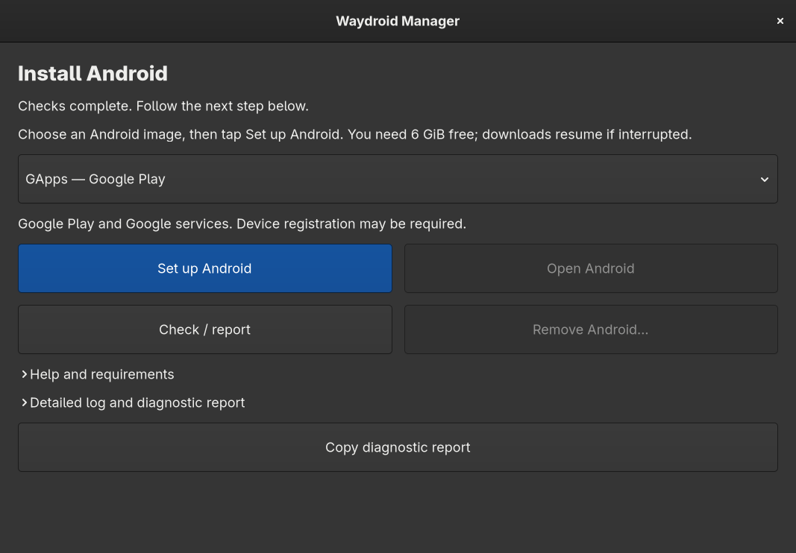
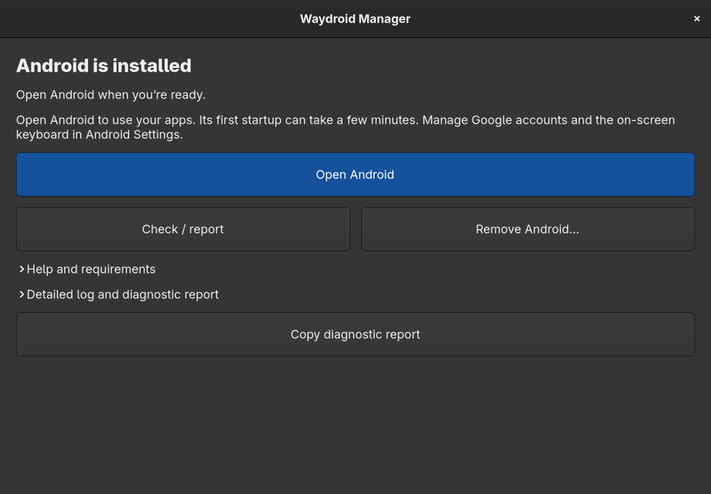

# Experimental Waydroid on the Daylight DC-1

Run Android 13 on a Daylight DC-1 with a custom kernel and native Alpine
Waydroid packages. On our DC-1 running Nura edge, GPU rendering, web browsing
and Brydge keyboard input worked. GNOME and Tailscale kept working too.

**Android needs interpreter mode to avoid a system-server crash.** Expect slow
startup and apps. We tested automatic fallback and manual recovery to the
original kernel.

Build locally using the scripts in this directory. This recipe is DC-1-specific
and does not use the glibc runtime. Follow the recovery steps before rebooting.

## Versions

| Component | Tested version |
| --- | --- |
| DC-1 packaging source | `denysvitali/dc-1-pmos` at `9a69db8fffc851e3670647621e5e021f2039301b` |
| Kernel source | `denysvitali/dc-1-linux-kernel` at `7cc767cd0cff39b77e252f26c9450d035c17b038` |
| Original kernel/packages | `7.2.0-rc5`, APK `7.2_rc5_git20260819-r67` |
| Trial kernel/packages | `7.2.0-rc5-waydroid4`, local APK `7.2_rc5_git20260819-r71` |
| Compiler | LLVM/Clang 20.1.8 |
| Waydroid | Alpine `1.6.3-r0`, with `waydroid-systemd` and `waydroid-nftrules` |
| Android system | VANILLA ARM64, Lineage 20 / Android 13, 20260927 |
| Android vendor | MAINLINE ARM64, 20261022 |

## Changes from the stock setup

These are the settings and setup changes used in the working installation.
We tested the set together; we did not remove each option in isolation to
establish a minimal configuration. The exact kernel fragment is
[`waydroid.config`](waydroid.config). `y` means built in; `m` means a module.

### Kernel configuration

| Group | Why it is included | Uses beyond Waydroid |
| --- | --- | --- |
| Binder and binderfs | Android interprocess communication and Binder devices | Android workloads |
| Loop and overlay | Mount Android images and layer writable files over them | Disk images and containers |
| Bridge, veth and nftables inet | Connect the container to the host network and apply Waydroid's packaged firewall rules | Container networking and firewalls |
| ARM32 compatibility and legacy time syscalls | The official ARM64 image also runs 32-bit vendor services; without the time compatibility option, ARM32 zygote hit `ENOSYS` | Other 32-bit ARM programs |
| POSIX message queues | Included in the container configuration | Programs using POSIX IPC |
| IPv4/IPv6 policy routing | Android assigns traffic to per-network routing tables; without it, Android could not install its routes | Advanced routing and VPN configurations |
| Legacy xtables, matches and targets | Android netd configures filtering, NAT, packet marks and accounting inside its network namespace | Linux firewalls and container networking |

The complete explicit configuration follows. Kconfig also selects dependencies.

```text
# Android IPC and container storage/networking for Waydroid.
# Binder is built-in-only in this kernel; auxiliary drivers load on demand.
CONFIG_ANDROID_BINDER_IPC=y
CONFIG_ANDROID_BINDERFS=y
CONFIG_BLK_DEV_LOOP=m
CONFIG_OVERLAY_FS=m
CONFIG_BRIDGE=m
CONFIG_VETH=m
# Alpine's Waydroid package uses nftables inet-family chains.
CONFIG_NF_TABLES_INET=y
# Official arm64 Android images also run 32-bit vendor services.
CONFIG_COMPAT=y
CONFIG_COMPAT_32BIT_TIME=y
CONFIG_POSIX_MQUEUE=y

# Android routes app traffic through per-network policy routing tables.
CONFIG_IP_ADVANCED_ROUTER=y
CONFIG_IP_MULTIPLE_TABLES=y
CONFIG_IPV6_MULTIPLE_TABLES=y

# Android netd uses legacy xtables inside its network namespace.
CONFIG_NETFILTER_XTABLES=m
CONFIG_NETFILTER_XTABLES_LEGACY=y
CONFIG_IP_NF_IPTABLES_LEGACY=m
CONFIG_IP6_NF_IPTABLES_LEGACY=m
CONFIG_NETFILTER_XT_MATCH_COMMENT=m
CONFIG_NETFILTER_XT_MATCH_CONNTRACK=m
CONFIG_NETFILTER_XT_MATCH_OWNER=m
CONFIG_NETFILTER_XT_MATCH_QUOTA=m
CONFIG_NETFILTER_XT_MATCH_BPF=m
CONFIG_NETFILTER_XT_MATCH_CGROUP=m
CONFIG_NETFILTER_XT_TARGET_MARK=m
CONFIG_NETFILTER_XT_TARGET_CONNMARK=m
CONFIG_NETFILTER_XT_TARGET_NFLOG=m
CONFIG_NETFILTER_XT_TARGET_TCPMSS=m
CONFIG_IP_NF_IPTABLES=m
CONFIG_IP_NF_FILTER=m
CONFIG_IP_NF_TARGET_REJECT=m
CONFIG_IP_NF_NAT=m
CONFIG_IP_NF_TARGET_MASQUERADE=m
CONFIG_IP_NF_MANGLE=m
CONFIG_IP_NF_RAW=m
CONFIG_IP6_NF_IPTABLES=m
CONFIG_IP6_NF_FILTER=m
CONFIG_IP6_NF_TARGET_REJECT=m
CONFIG_IP6_NF_MANGLE=m
CONFIG_IP6_NF_NAT=m
CONFIG_IP6_NF_TARGET_MASQUERADE=m
CONFIG_IP6_NF_RAW=m
```

### Kernel packaging and installation

- Add the fragment to the APKBUILD sources and SHA512 checksums, apply it before
  `olddefconfig`, and check that every requested `y`/`m` value survives Kconfig.
  Include the fragment in the configuration regression tests.
- Bump the local package release from `r67` to `r71`. Keep upstream's split
  kernel/modules packages and exact version dependency.
- Set `CONFIG_LOCALVERSION="-waydroid4"` and disable
  `CONFIG_LOCALVERSION_AUTO`. The separate module directory lets the original
  kernel's modules coexist during recovery.
- Adjust the installer to accept variable whitespace in `dc1-slotctl` output.
- Allow the inactive slot to contain an Android boot image without a dtbswap
  payload. Back it up without requiring that format; still require the running
  Linux image to match exactly one slot and validate the candidate before writing.

See [`kernel.patch`](kernel.patch), [`installer.patch`](installer.patch) and
[`prepare-kernel.sh`](prepare-kernel.sh). These changes retain the pinned kernel
source and upstream driver patches; they add no Waydroid-specific driver code.

### Android and host setup

- Install native Alpine `waydroid`, `waydroid-systemd`, `waydroid-nftrules` and
  `unzip`, then the pinned VANILLA system and MAINLINE vendor images below.
- Set `dalvik.vm.extra-opts=-Xint` and `dalvik.vm.usejit=false`. Both are needed
  for the working interpreter configuration; the default runtime crashes.
- Make `waydroid.cfg` readable by the desktop user (`0644`) and regenerate the
  runtime configuration with `waydroid upgrade -o`.
- Enable the packaged Waydroid nftables include and load the legacy IPv4/IPv6
  filter, NAT, mangle and raw-table modules. Preserve existing firewall rules.
- Enable the container service after testing. Keep Android's user session on
  demand with the autostart override.
- Restart the Android session after fixing config permissions; that restored
  Brydge typing. Optionally set `show_ime_with_hard_keyboard=0` to hide Android's
  screen keyboard.
- Optionally install Aurora Store and F-Droid as Android APKs. These provide app
  stores, not Google Play services; GApps remains a separate change.

### Recovery added for this experiment

- Save the original module tree and retain the installer's boot-slot and APK
  backups. Restore original modules alongside the candidate before rebooting.
- Pause automatic updates during the test, block automatic kernel confirmation,
  and arm a ten-minute reboot timer. Keep the original Linux slot bootable.
- After testing, save the recovery transaction, confirm the candidate, disable
  the timer, and remove the update pause created by this experiment. Retain
  the APK world constraint that pins the custom kernel.
- Install `dc1-waydroid-rollback` to verify the saved original image/packages,
  select the original slot and restore its packages after reboot.

The sections below give the order and commands for applying these changes.

## Build the kernel

Use native aarch64 Linux and the pinned upstream build prerequisites, including
pmbootstrap, Python, Git, Go and LLVM 20 inside its build environment. The
upstream build script uses sudo for its chroots; keep those calls intact.

From the repository root:

```sh
./experiments/waydroid/prepare-kernel.sh
cd out/waydroid/dc-1-pmos
sh scripts/kernel-local.sh build
```

Preparation refuses an existing destination. It checks out the exact upstream
commit, applies the kernel and installer patches, and adds the config fragment
and release suffix. It never flashes hardware. The build produces the kernel
and matching modules APKs under
`work/pmbootstrap-work/packages/edge/aarch64/`; public signing keys are under
`work/pmbootstrap-work/config_apk_keys/`. Keep private signing keys on the builder.

We built the tested kernel in an Alpine container using the original device
trees (DTBs). The wrapper here uses upstream's pmbootstrap recipe, which also
builds DTBs. Checkout preparation and all 11 config tests pass; we have not
repeated the full build and device installation through this wrapper.
Use a new recovery transaction for each build, with its own checksums.

## Prepare recovery before installing

Start with a charged DC-1 running its original Linux kernel and working SSH.
Back up important data and stay with the tablet for the first boot.

Copy the prepared source checkout, both APKs, public keys, and this repository's
`experiments/waydroid` directory to the tablet. Build the boot-image helper on
aarch64 Linux with `(cd boot/mkboot && go build -o mkboot .)` inside the prepared
checkout. Keep its executable in that checkout.

The guarded installer requires the installed `dc1-boot-sync` helper to match its
pinned source exactly. It also checks boot-image provenance, installed kernel
parity, APK signatures and availability of the original packages. If a check
fails, resolve the mismatch before proceeding.

Record `uname -r` and `dc1-slotctl status`. Run the supplied recovery preparation
script as root (use absolute paths with graphical polkit):

```sh
pkexec /absolute/path/experiments/waydroid/arm-recovery.sh
```

It backs up the original module tree, pauses automatic updates, installs a
confirmation gate, and enables a ten-minute timer for the candidate kernel.
It refuses a pending or previously accepted experiment. Keep the original
Linux slot intact. Never write preloader, lk, dtbo or vendor_boot partitions.

Stage with the prepared checkout's guarded installer. Replace the paths below:

```sh
pkexec /usr/bin/python3 /absolute/path/dc-1-pmos/scripts/kernel-local-install.py \
  install /absolute/path/dc-1-pmos \
  /absolute/path/apks/linux-postmarketos-mediatek-mt6789-7.2_rc5_git20260819-r71.apk \
  /absolute/path/public-keys
```

The modules APK must sit beside the kernel APK. The installer backs up both
boot slots and original APKs under `/var/lib/dc1/local-kernel/`, verifies the new
image by readback, and arms the inactive slot for one attempt. Its local patches
handle whitespace in slot status and an inactive Android image without a
dtbswap payload; the active Linux image and candidate still undergo validation.

Before rebooting, restore original modules alongside the candidate modules:

```sh
pkexec /usr/bin/tar -xf /var/lib/dc1/waydroid-test/rollback/modules.tar -C /
```

Verify both module directories exist, `pending.json` exists under
`/var/lib/dc1/local-kernel`, the confirmation service uses `confirm-gate.py`,
and `dc1-waydroid-recovery.timer` is enabled. Then reboot. The candidate is
`7.2.0-rc5-waydroid4`. **Do not mark the slot successful yourself.**

If testing is unfinished, let the ten-minute timer reboot to the proven slot.
A kernel that cannot reach userspace relies on the bootloader/watchdog fallback,
not the userspace timer. Following fallback, confirm the original kernel,
matching packages, GNOME and input work; automatic updates remain paused for
review.

## Android userspace

### Setup app

Choose **Vanilla** without Google services or **GApps** with Google Play.
Both images have been confirmed working on our DC-1. GApps may require
[Google Play device registration](https://docs.waydro.id/faq/google-play-certification).

After installing and booting the Waydroid-capable kernel, install the helper
from this repository on the tablet:

```sh
pkexec /bin/sh "$(pwd)/experiments/waydroid/install-setup.sh"
```

The checker reads `/proc/config.gz` or `/boot/config-$(uname -r)`. If neither
exists, copy the **full `.config` from the running kernel's build** to the latter
path as root. Do not use `waydroid.config`: it is only a fragment. Without a
matching full config, setup stops and the report says the requirements are
unreadable.

Open **Waydroid Manager** from Applications. Choose an image, then **Set up
Android**. The helper installs the Alpine packages, verifies the pinned image
sizes and SHA256 hashes, applies the interpreter settings and enables the
container. It needs 6 GiB free and downloads 1–1.5 GB. It never flashes a kernel
or changes boot slots. Download it before starting a timed kernel test; the
setup can take longer than the recovery timer.

**Check / report** collects kernel requirements, package versions, container
state and configuration checks. **Copy report** includes the last operation's
status. Review it before posting with a description of the problem. It excludes
journals, account details, network addresses and device identifiers.

Downloads use aria2 with up to four connections, retries and resume support.
SourceForge selects the mirror through its download endpoint. Partial files and
aria2's control files stay in the cache after an interrupted transfer; retrying
resumes them. **Stop download** preserves progress; **Resume setup** continues
with the same image choice. Stop is available only during downloading, not
package installation or image extraction. Size and SHA256 checks must pass before an image is used.

During downloads, the progress bar shows the current image, downloaded MiB,
average speed and estimated time remaining for that file. Verification,
extraction and package installation show their current stage without a percentage.

Setup refuses to reinitialize an existing Android installation or switch its
image choice. A failed setup can resume with the same choice; completed archives
are retained and verified again.

**Open Android** checks Android’s boot-completed property for up to three
minutes. If startup fails or times out, the manager keeps the error visible and
opens the diagnostic report. It leaves Android running after a timeout so a slow
startup can still finish.

### Remove Android

Choose **Remove Android…** in Waydroid Manager. By default, this stops the
container and removes the Waydroid packages while keeping Android apps, data
and images. Check **Also delete Android apps, data and downloaded images** for
a clean start, including switching between Vanilla and GApps. Deletion cannot
be undone. It removes shared Android data and the invoking desktop user's
Android data; other desktop users' home directories are untouched.

Removal leaves the Linux kernel, boot slots and recovery files in place. It
refuses to delete files while Android mounts remain active. The setup app stays
installed so you can collect a report or reinstall Android.

The same operations are available from a terminal:

```sh
dc1-waydroid-setup report
pkexec /usr/local/bin/dc1-waydroid-setup setup --variant vanilla
# Or choose --variant gapps for a new installation.
pkexec /usr/local/bin/dc1-waydroid-setup remove
# Delete apps, data and images too (irreversible):
pkexec /usr/local/bin/dc1-waydroid-setup remove --erase-data
```

### Helper validation

Unit and aria2 integration tests cover image verification and selection, repeat setup,
existing-install protection, configuration preservation, removal defaults,
explicit erasure and active-mount refusal. The GUI launches on the DC-1 and its
report detects the running container and installed packages. We verified that
setup refuses the existing Android installation. The owner completed removal and installation through the GUI and confirmed
both Vanilla and GApps work. The aria2 downloader completed both Vanilla
images on the tablet with matching SHA256 hashes. A local HTTP fixture verified
that interrupting aria2 and retrying sends a nonzero Range request and produces
the exact original file.

### Manual setup

Download the pinned official images before the timed test:

```sh
python3 experiments/waydroid/fetch-images.py out/waydroid/images
```

The downloader verifies size and SHA256 against the saved official OTA records
in `images.json`. Copy the verified ZIPs to the tablet. Install the native
`waydroid`, `waydroid-systemd`, `waydroid-nftrules` and `unzip` packages using APK.
Mask `waydroid-container.service` until the candidate kernel is running.
Extract the two ZIPs into `/usr/share/waydroid-extra/images` as root. Do not
replace images or reinitialize an existing Android installation without a
separate backup of its configuration and userdata.

On the candidate kernel, initialize with `waydroid init -s VANILLA` as root.
Check that it uses the preinstalled images. In `/var/lib/waydroid/waydroid.cfg`, add
these entries to its existing `[properties]` section:

```ini
dalvik.vm.extra-opts = -Xint
dalvik.vm.usejit = false
```

Keep the config readable by the desktop user (`chmod 644`). Mode `600`
prevented the Binder helper from reading it. Run `waydroid upgrade -o` as root to
regenerate the configuration without fetching images.

Enable the packaged Waydroid nftables include by linking
`/usr/share/nftables.avail/51_waydroid.nft` into `/etc/nftables.d/51_waydroid.nft`.
Validate with `nft -c -f` and load the file with `nft -f` if those rules are not
already present. Review interaction with your existing firewall; do not flush
its rules. Load `iptable_filter`, `iptable_nat`, `iptable_mangle`, `iptable_raw`
and the corresponding `ip6table_*` modules. Unmask and start
`waydroid-container.service`.

As the logged-in Wayland desktop user, run:

```sh
waydroid show-full-ui
```

Startup took about two minutes. To start Android only when needed, put this in
`~/.config/autostart/waydroid-session.desktop`:

```ini
[Desktop Entry]
Type=Application
Name=Waydroid Session
Hidden=true
```

## Test, then accept

Before the deadline, check GNOME, Wi-Fi, your keyboard/trackpad and Android.
As root, check `waydroid shell getprop sys.boot_completed` returns `1`; test
Android DNS and an HTTPS page, and check
`waydroid shell -- dumpsys SurfaceFlinger` for the GPU renderer. Our tablet
reported Mali-G57 MC2 / Panfrost / Mesa 26.0.8. Test touch and typing in an
Android text field. Check host browsing and any VPN as well.

`waydroid shell` did not reliably propagate command failures to the host exit
status. Read the output; exit code `0` alone does not establish success.

After passing those checks, run:

```sh
pkexec /absolute/path/experiments/waydroid/accept-kernel.sh
```

This saves the recovery transaction, verifies recovery assets, permits the
normal kernel confirmation checks, disables the test timer, and enables the
container daemon. It removes only the update-pause marker this experiment
created. The local kernel remains pinned by APK's world constraint. Keep both
local APKs cached and the build's public signing key available for maintenance;
compare an existing key before installing it, never overwrite a different one.

You maintain this custom kernel; upstream updates do not cover it.
Do not remove its pin or install a replacement kernel without planning a new
recovery test. Later boot-slot writes can invalidate the saved rollback.

## Return to the original kernel

Save your work. These commands run on the tablet after accepting the candidate:

```sh
pkexec /usr/local/sbin/dc1-waydroid-rollback --check
pkexec /usr/local/sbin/dc1-waydroid-rollback
```

The second command stops Android and reboots. It checks the running build,
original boot-image bytes and original package hashes, selects the retained
proven slot, restores its modules, and lets the confirmation service restore
its matching packages after boot. It refuses stale or inconsistent recovery
records and keeps Android userdata. We tested this rollback, then reinstalled
and confirmed the Waydroid kernel.

Do not delete `/var/lib/dc1/waydroid-test` or `/var/lib/dc1/local-kernel` while
relying on this recovery path. After fallback, updates are paused deliberately;
review the restored state before removing `/var/lib/dc1/no-auto-update`.

## App installation and keyboard

We also installed [Aurora Store](https://f-droid.org/packages/com.aurora.store/)
4.8.4 and [F-Droid](https://f-droid.org/) 2.0.2 from F-Droid's official downloads.
Install downloaded Android APKs as the desktop user:

```sh
waydroid app install /path/to/application.apk
```

Aurora reached sign-in. We have not tested downloads through either store.
Aurora supports anonymous access to Google Play apps, but does not install
Google Play services. Apps that require those services need a separate GApps
setup. These Android APKs are unrelated to Alpine packages.

After fixing the config permissions, we had to restart Android before the
Brydge could type. Restart with `waydroid session stop`, then
`waydroid show-full-ui`.

To hide Android's screen keyboard, open **Android Settings → System →
Languages & input → Physical keyboard** and turn **Use on-screen keyboard**
off. Turn it back on when you want the screen keyboard. This is an Android
setting, separate from GNOME's screen keyboard.

For scripts, the equivalent command is (run as root):

```sh
waydroid shell -- settings put secure show_ime_with_hard_keyboard 0
```

This Android preference persists across boots; no boot script is needed.
Use `1` to turn it back on. The [Android Settings toggle](https://github.com/LineageOS/android_packages_apps_Settings/blob/lineage-20.0/src/com/android/settings/inputmethod/PhysicalKeyboardFragment.java)
writes this same setting. Waydroid exposes a persistent virtual hardware keyboard,
so Bluetooth disconnection may not automatically bring the screen keyboard back.

## Remaining issues

- Default ART and JIT-off alone crashed `system_server`. Keep both interpreter
  flags. [Waydroid issue #2040](https://github.com/waydroid/waydroid/issues/2040)
  reports a related ARM64 Alpine crash; the cause is unresolved.
- Physical touch/gestures, audio, camera, suspend, DRM, banking apps,
  Play Integrity and long-term stability remain untested.
- Android image updates are manual.

## Files

| File | Purpose |
| --- | --- |
| `prepare-kernel.sh` | Checks out pinned upstream sources and applies the local recipe changes; does not flash hardware. |
| `kernel.patch`, `waydroid.config` | Kernel package changes and required configuration. |
| `installer.patch` | Local adjustments to upstream's guarded kernel installer. |
| `images.json`, `fetch-images.py` | Official Android image pins and download verification. |
| `arm-recovery.sh` | Prepares original modules, the confirmation gate and timed fallback before installation. |
| `accept-kernel.sh` | Confirms a tested candidate and disables its test timer. |
| `dc1-waydroid-rollback` | Checks retained recovery assets and restores the original kernel after acceptance. |
| `LICENSE.upstream` | License notice for upstream packaging and installer code. |

## Licenses

The underlying kernel retains GPL-2.0-only licensing. Upstream packaging and
installer code retain Denys Vitali's MIT notice in
[`LICENSE.upstream`](LICENSE.upstream). Local scripts and
documentation follow this repository's MIT license.

## Manager screenshots

Captured on the DC-1. The install screen previews the pre-install state;
Android was not removed for the capture.



After installation, Open Android becomes the primary action:



**Stop Android** closes Android apps and stops the session without removing
installed apps or data. Save work in Android apps first. Use **Open Android**
to start it again; no administrator prompt is needed.
